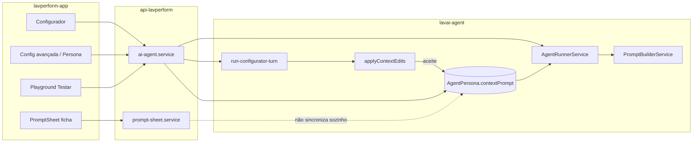

# Investigação preliminar — IA Lav Perform não reflete o que foi “gravado”

**Data:** 2026-11-27  
**Escopo:** só diagnóstico (sem correção neste documento)  
**Contexto:** relatos no grupo (Black Friday / lavanderias), print do configurador vs “Testar agente”, ajustes do Andrey (PRs #173 e #174 mergeados na `main` ~13h15–13h49).

---

## Resumo executivo

O sintoma mais visível no print (**esquerda:** configurador mostra cobertor solteiro R$ 40 e “Alteração gravada”; **direita:** “Testar agente” diz que não sabe o valor e manda falar com ATENDENTE) **não prova sozinho que o banco não gravou**. Ele é compatível com **dois motores de teste diferentes**:

| Lado | O que é | Fonte da “inteligência” |
|------|---------|-------------------------|
| Esquerda | Chat do **configurador** (agente interno) | LLM do configurador + snapshot de `ler_agente` + proposta/aceite |
| Direita | **Playground** (`?teste=1`) | `RunPlaygroundTurnUseCase` → `AgentRunnerService` → persona **persistida** no LavAI Agent + guardrails de “não inventar” |

Ou seja: a pessoa pode ver uma resposta “certa” na conversa do configurador e, ao mesmo tempo, o agente público de teste obedecer à regra **“só afirme o que está no contexto gravado”** — e o trecho do solteiro pode **não estar** (ou não estar legível) no `contextPrompt` que o runner monta.

Ainda assim, há **vários pontos reais de falha** no desenho atual que explicam “prompt não altera”, “teste não responde” e divergência com o FoodChat.

---

## O que mudou hoje (relevante para o incidente)

### PR #174 — configurador só edita `contextPrompt`

- Propostas passam por `applyContextEdits` (troca pontual + `addition`), não reescrita dos 4 campos.
- Aceite grava **apenas** `{ contextPrompt }` no persona (foco, diretrizes e guardrails ficam fixos no template padrão).
- Propostas **antigas** (sem lista `changes`) são **rejeitadas** no aceite → mensagem do tipo “O texto mudou. Peça a alteração de novo.”
- UI passou a invalidar cache do agente após aceite (evita configuração avançada salvar texto velho por cima).
- `PromptBuilderService` ganhou regra explícita: contexto da lavanderia **prioriza** conduta, com exceções rígidas (não inventar fatos, etc.).
- Migration **sobrescreve** todos os agentes: `window_size=100`, `temperature=0.3`, `max_tokens=16384`.

### PR #173 — criação de agente / empresa órfã

- Corrige 500 ao criar agente quando `overAgentCompanyId` não existe no LavAI Agent.
- Não é a causa direta do cobertor, mas explica cenários em que “nada acontece” ao criar agente.

**Hipótese operacional:** teste de manhã pode ter sido em branch/ambiente; produção/homolog só passou a ter o fluxo novo após merge ~13h49. Vale confirmar **versão deployada** de `lavai-agent`, `api-lavperform` e `lavperform-app`.

---

## Fluxo de dados (onde a informação deveria morar)

Pontos críticos:

1. **Ficha (`PromptSheet.answers`)** e **persona (`contextPrompt`)** são **dois armazenamentos**. Atualizar a ficha **não** atualiza o agente automaticamente; só entra no prompt na criação (`fillWhatsappPrompt`), em proposta com `answerKey`/`answerValue`, ou edição manual.
2. O configurador lê a ficha no turno, mas a gravação no aceite mexe **só no `contextPrompt`**.
3. WhatsApp e playground usam o **mesmo runner** (com jornada, RAG, guardrails).

---

## Hipóteses ranqueadas (causa provável → secundária)

### H1 — Texto aceito não entrou no trecho que o runner usa (alta)

- Preço do solteiro pode ter ficado só na **resposta markdown do configurador** (“comportamento que o agente passa a fazer”) ou na **ficha**, sem `addition`/`replacements` válidos no `contextPrompt`.
- `applyContextEdits` falha se:
  - `before` não for cópia **exata** do contexto;
  - trecho aparece mais de uma vez;
  - troca > 12 linhas;
  - `addition` duplicada (considerada “nada mudaria”).
- O modelo pode chamar `propor_mudanca`, a ferramenta devolver recusa, e o turno terminar com `NOTHING_CHANGED_MESSAGE` — mas o usuário ainda ver texto “otimista” no markdown se o LLM desobedecer ao prompt do configurador.

**Como validar:** comparar `contextPrompt` no banco (ou GET persona) com o texto mostrado na proposta aceita; buscar literalmente “solteiro” / “40”.

### H2 — Confusão entre “alteração gravada” e efeito no agente público (alta)

- “Alteração gravada” = status da **proposta do configurador** aceita via API `decideConfiguratorProposal`, não garantia de que o playground foi recarregado na mesma sessão (cache React Query foi melhorado no PR #174, mas sessão antiga do playground pode manter histórico).
- Preview embutido na **esquerda** não é o mesmo endpoint que a **direita** (`sendPlaygroundTurn`).

**Como validar:** após aceite, abrir configuração avançada → campo contexto; rodar playground em aba anônima; repetir pergunta sem histórico.

### H3 — Guardrails + migração “não inventar” (média/alta)

Desde o padrão de conduta (nov/2025–2026), o system prompt e `FACTS_RULE` obrigam: preço só se estiver no contexto/base/RAG. Resposta “não foi confirmado pra mim” + ATENDENTE é **comportamento esperado** do template quando o fato falta no `contextPrompt`.

No print: **casal R$ 50** aparece no teste; **solteiro** não — padrão clássico de **informação parcial** no contexto (só um dos dois preços gravado ou gravado em bloco legado que o modelo trata como secundário).

**Como validar:** inspecionar se casal e solteiro estão no mesmo bloco/seção do `contextPrompt`; ver se existe bloco `## Informações já cadastradas desta lavanderia` com regra de prioridade.

### H4 — Propostas antigas / deploy parcial (média)

- Aceite de proposta criada **antes** do deploy #174 falha (`!input.changes` → rejeição).
- Ambiente com app novo e API/agent antigo (ou vice-versa) quebra formato de blocos/proposta.

**Como validar:** horário da mensagem da proposta vs horário do deploy; logs do `lavai-agent` no `decideProposal`.

### H5 — Configuração avançada sobrescreve contexto (média, mitigado)

Antes do #174: aceitar no configurador e salvar na persona sem recarregar podia **regravar contexto antigo**. PR #174 adiciona `invalidateQueries.aiAgentDetail` no aceite. Ainda é possível se o usuário tinha formulário aberto com texto velho.

### H6 — Edição via chat de ajuste (Prompt Studio) vs configurador (média)

`propose-prompt-edit` também só mexe em `contextPrompt`, com validação `applyContextEdits` e até 2 tentativas com o LLM. Falhas viram 502/conflict sem gravar.

`testPromptStudio` usa documento **em memória** (`activeDocument` / `pendingDocument`); pode mostrar resposta certa **sem** PATCH no servidor.

### H7 — Dois testes na UI (média)

| Mecanismo | Endpoint | Usa persona salva? |
|-----------|----------|-------------------|
| Painel “teste” na persona/wizard | `testPromptStudio` | Não necessariamente (envia `document` do form) |
| Playground / Testar no configurador | `playground/turns` | Sim |

Relato “prompt uma coisa teste não responde” pode ser **teste local certo** + **WhatsApp/playground errado**.

### H8 — RAG / base de conhecimento (baixa/média)

Runner injeta chunks se houver embedding. Divergência contexto vs base aciona regra “não escolha um lado; encaminhe atendente”. Improvável ser só RAG se o preço nem está no contexto.

### H9 — Intervenção da IA com humano no WhatsApp (reclamação separada)

Print da Lavanderia Mayta: IA continua falando com atendente humano ativo. É **outro eixo** (jornada, takeover, buffer, pausa de digitação) — não explica cobertor no playground, mas é prioridade de produto.

---

## Comparação com FoodChat (por que lá “não reclamam” do mesmo jeito)

| Aspecto | Lav Perform | FoodChat (worktree `foodchat-chamado-garcom`) |
|---------|-------------|-----------------------------------------------|
| Onde vive o prompt | LavAI Agent (serviço separado) + sync de empresa | Monólito `apps/api` |
| Edição do negócio | Configurador + ficha + migração para conduta padrão | Edição direta da persona / campos no admin |
| Fatos vs conduta | Split forte: conduta fixa + `contextPrompt`; ficha separada | `contextPrompt` no mesmo modelo mental do admin |
| Teste | Playground (runner real) **vs** `testPromptStudio` (documento enviado) | Menos camadas; runner mais previsível |
| Regras extras | `FACTS_RULE`, bloco preservado pós-migração, prioridade contexto vs guardrails | Prompt builder mais simples; regras de promoção por dia da semana |
| Configurador com LLM reescrevendo prompt | Sim (fluxo complexo, validação `before`/`after`) | Não há equivalente com mesma complexidade |

FoodChat não é “magicamente melhor”: é **menos estados** (menos lugares para o fato se perder). Lav Perform concentra risco na **sincronização ficha → `contextPrompt` → aceite → teste**.

---

## Checklist de validação recomendado (próximo passo técnico)

1. **Ambiente:** commit/imagens de `lavai-agent`, `api-lavperform`, app em homolog/prod.
2. **Agente da unidade do print:** `GET` persona → `contextPrompt` contém “solteiro” e “40”?
3. **Última proposta aceita:** `blocksJson` da mensagem no configurador → `changes` e `document.contextPrompt`.
4. **Reproduzir aceite:** pedir preço no configurador, aceitar, **sem** abrir config avançada antes → playground só com “e solteiro?”.
5. **Logs:** `applyContextEdits` recusando proposta (`Proposta recusada. O trecho não foi encontrado...`).
6. **WhatsApp:** mesma pergunta após aceite (confirma se problema é só UI de teste ou produção).
7. **PromptSheet:** campo `priceOther` / respostas de cobertor na ficha vs texto no `contextPrompt`.

---

## O que os testes unitários cobrem (e o que não cobrem)

- Boa cobertura de `applyContextEdits`, `decideProposal`, parse de proposta, prompt builder com prioridade de contexto.
- **Gap provável:** teste E2E “usuário descreve preço no chat → aceita → playground no WhatsApp responde o preço” com LLM real; deploy homolog vs prod; race entre invalidate cache e playground aberto.

---

## Conclusão preliminar

1. O incidente do print é **consistente** com contexto **parcialmente gravado** (casal sim, solteiro não) + runner correto recusando inventar — **não** necessariamente com falha total de persistência.
2. O stack Lav Perform tem **múltiplos caminhos de edição e de teste**; é fácil achar que “gravou” quando só o configurador **explicou** a mudança ou o teste usou documento não salvo.
3. O PR #174 **reduz** reescrita perigosa do prompt, mas **aumenta** exigência de edições pontuais corretas; propostas antigas e LLM que não acerta o `before` geram “não altera”.
4. FoodChat sofre menos porque **não duplica** ficha + contexto + configurador + dois tipos de teste no mesmo fluxo operacional.

**Recomendação de produto (investigação, não implementação):** até fechar a causa, tratar “Testar agente” como fonte da verdade para o cliente final; após aceite no configurador, forçar reload do agente no playground; expor no card de proposta o trecho exato que será gravado no `contextPrompt`.

---

## Referências no código (worktree `main` / 2026-11-27)

- `apps/lavai-agent/.../context-edits.ts` — validação de gravação
- `apps/lavai-agent/.../decide-configurator-proposal.use-case.ts` — PATCH só `contextPrompt`
- `apps/lavai-agent/.../run-playground-turn.use-case.ts` — teste usa runner + persona DB
- `apps/lavai-agent/.../prompt-builder.service.ts` — `FACTS_RULE`, prioridade do contexto
- `apps/lavperform-app/.../AIAgentConfiguratorPage` — split configurador / playground
- `apps/lavperform-app/.../PersonaTab.tsx` — `testPromptStudio` vs persona salva
- `apps/api-lavperform/.../prompt-sheet.service.ts` — ficha isolada da persona